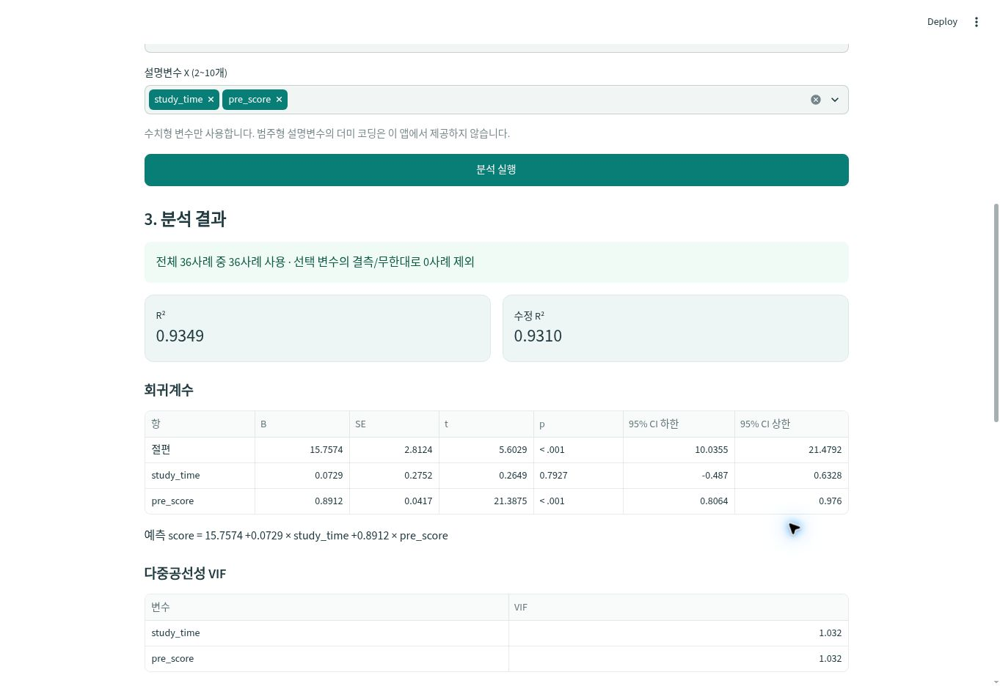

# 데이터 한눈에

**은수현 · 김정훈 · 김응범**의 데이터분석 웹앱 과제입니다. 엑셀과 CSV를 불러와 통계분석, 그래프, 한국어 해석을 확인하고 결과를 내려받습니다.

**[앱 바로 실행하기](https://4mlyngvxcnuchcxkbzspn8.streamlit.app/)** · [GitHub 소스](https://github.com/KEBEOM/kumho_bigdata_8)

Streamlit Community Cloud에 배포했습니다. PC와 스마트폰 브라우저에서 위 실행 주소로 접속합니다. 이용자는 로그인이나 Python 설치가 필요 없습니다. 개발용 PC에서 직접 실행하는 방식도 지원합니다.

2026-11-24에 로그인 없는 접속, 36사례·14변수 표시, 다중회귀 R²=0.9349, 결과 엑셀 다운로드 동작을 확인했습니다. 검증 범위는 [배포 확인 기록](docs/배포확인.md)에 있습니다.

## 분석 기능

| 분석 | 주요 결과 |
|---|---|
| 기초통계 | 평균, 표본 표준편차, 사분위수, 빈도표, 분포 그래프 |
| 단순회귀 | 회귀식, 계수, 신뢰구간, R², 회귀선 |
| 다중회귀 | 계수, 수정 R², VIF, 잔차 진단 |
| 일원분산분석 | ANOVA, 효과크기, Tukey HSD, Levene 검정 |
| 이원분산분석 | 주효과·상호작용, Type II/III, 부분 η² |
| 매개효과 | a·b·c·c′, 간접효과, 부트스트랩 신뢰구간 |
| 조절효과 | 상호작용, ΔR², 단순기울기, 예측선 |

기본으로 제공하는 36사례 가상 데이터만으로 모든 분석을 연습할 수 있습니다. 자신의 자료는 `.xlsx`, `.xls`, `.csv` 형식으로 올립니다. 제한은 10MB, 10,000행, 100열입니다.



## 내 컴퓨터에서 실행

ZIP 전체를 해제하고 `app.py`가 있는 폴더를 엽니다.

- **Windows:** `run_windows.bat` 실행
- **macOS:** `run_mac.command` 실행
- **macOS/Linux 터미널:** `bash run_mac_linux.sh`

64비트 CPython **3.9~3.14** 중 하나가 필요합니다. Streamlit이 지원하지 않는 **3.9.7은 제외**합니다. 최초 실행 시 전용 가상환경과 패키지를 준비합니다. 브라우저에서 `http://localhost:8501`을 열고, 사용하는 동안 터미널을 켜 둡니다.

수동 설치를 원하는 경우 가상환경 안에서 실행합니다.

```bash
python -m pip install -r requirements.txt
python -m streamlit run app.py
```

같은 Wi-Fi의 스마트폰 연결 등 자세한 사용법은 [README.txt](README.txt)에 있습니다.

## GitHub와 Streamlit 배포

소스 저장소: https://github.com/KEBEOM/kumho_bigdata_8

GitHub는 소스와 변경 이력을 관리합니다. 앱 실행 서버는 Streamlit Community Cloud입니다. **ZIP만 GitHub에 올려서는 앱이 실행되지 않습니다.** 압축을 푼 소스 파일을 저장소에 올려야 합니다.

| 배포 항목 | 입력값 |
|---|---|
| Repository | `KEBEOM/kumho_bigdata_8` |
| Branch | `main` |
| Main file path | `app.py` |
| Python version | `3.12` 권장, 클라우드에서 지원하는 다른 검증 버전도 가능 |
| Secrets | 입력할 값 없음 |

`app.py`와 `requirements.txt`는 저장소 최상위에 둡니다. 배포 시에는 로컬 실행기인 `start.py`를 지정하지 않습니다. 자세한 절차와 점검 항목은 [GitHub·배포 안내](docs/GITHUB_DEPLOY.md)를 참고합니다.

배포 서버의 Python 선택과 이용자의 기기 환경은 별개입니다. 서버에서 Python 3.12를 선택해도 이용자의 PC나 스마트폰에 3.12를 설치할 필요가 없습니다.

## 검증

Linux의 독립된 Python 3.9~3.14 환경에서 각각 **59개 테스트 통과**, 교수자 기준값 **34/34개 일치**를 확인했습니다. 세부 패치 버전과 한계는 [호환성보고서](docs/호환성보고서.md)에 기록했습니다. Windows/macOS 실기기와 실제 스마트폰 검증은 별도입니다.

```bash
python -m pip install -r requirements-dev.txt
python -m pytest -q tests
```

GitHub Actions 설정은 코드 변경 시 6개 Python 버전을 검사하도록 구성했습니다. 원격 실행 결과는 저장소의 **Actions → Python compatibility**에서 확인합니다. 로컬 검사와 원격 Actions 실행 결과는 구분합니다.

## 파일 안내

| 파일·폴더 | 역할 |
|---|---|
| `app.py` | 화면, 입력, 결과 표시와 다운로드 |
| `analysis.py` | 통계 계산과 검증 |
| `data_io.py` | 엑셀·CSV 읽기와 결과 내보내기 |
| `start.py`, 실행 스크립트 | 로컬 환경 준비와 실행 |
| `sample.xlsx` | 가상 기준 데이터 |
| `tests/` | 통계·화면·실행기 검사 |
| `prompts/` | 마스터 프롬프트와 코딩 프롬프트 |
| `docs/` | 검산표, 호환성 기록, 배포 안내 |
| `.github/workflows/tests.yml` | GitHub 자동 검사 |

## 자료 처리와 한계

업로드 자료는 앱이 실행되는 서버에서 계산합니다. 로컬 실행 시에는 내 PC, 클라우드 배포 시에는 배포 서버로 전달됩니다. 앱 코드에는 업로드를 별도 파일로 자동 저장하거나 생성형 AI로 전송하는 기능이 없습니다. 공개 시연은 제공된 가상 데이터로 진행합니다.

교육용 분석 도구이며, 관찰자료의 통계적 관계로 인과관계를 단정하지 않습니다. 반복측정·군집 구조 보정, 범주형 회귀, Welch ANOVA, 결측 대체 등은 지원하지 않습니다. 계산 규칙과 해석 한계는 [README.txt](README.txt)에 있습니다.

첨부 설명서·starter·교수자 기준 자료를 바탕으로 AI의 도움을 받아 구현했습니다. 임의의 팀원 역할이나 활동 기록은 작성하지 않았습니다.
